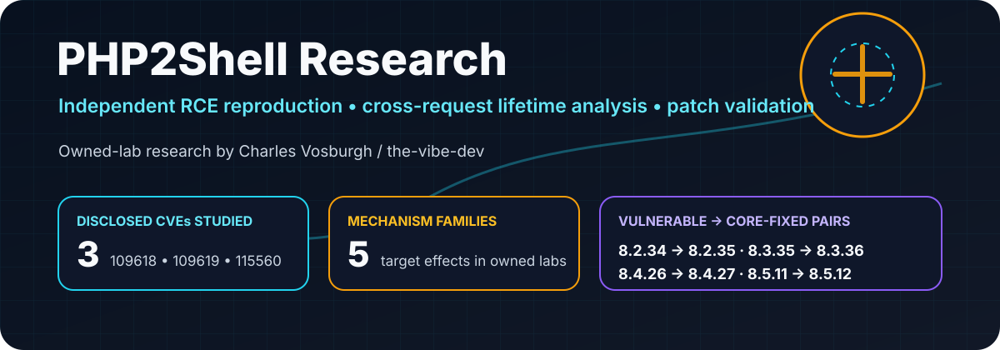
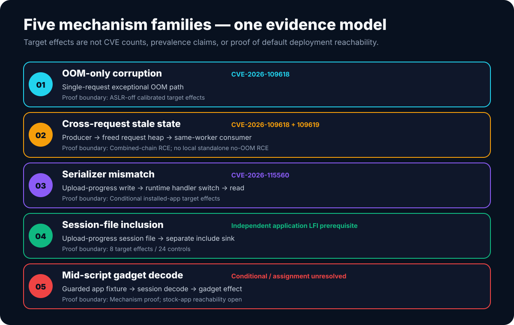

<p align="center"></p>

# PHP2Shell: reproducing the bugs, testing the boundaries

**Independent research by Charles Vosburgh · [the-vibe-dev](https://github.com/the-vibe-dev)**

[Technical report](docs/technical-report.md) · [Application results](docs/application-results.md) · [Evidence and counting](docs/evidence-and-counting.md) · [Public review tools](pocs/README.md) · [Publication audit](audit/AUDIT_SUMMARY.md) · [Research access](RESEARCH_ACCESS.md)

Between October 23 and November 2, 2026, I spent time reproducing and stress-testing the group of PHP issues that became widely known as **PHP2Shell**.

The work centered on three disclosed vulnerabilities:

- **CVE-2026-109618** — exceptional OOM behavior can leave request state partially initialized and unsafe for later shutdown processing.
- **CVE-2026-109619** — request-owned state can survive across requests in a persistent worker and be consumed after the original request heap is gone.
- **CVE-2026-115560** — a separate session upload-progress / serializer mismatch that becomes exploitable only when several application and configuration conditions line up.

I did not discover those CVEs, and this repository does not claim otherwise. The PHP project and the original reporters deserve the disclosure credit.

My goal was narrower and more practical: **find out exactly what I could reproduce, what survived fixed-version controls, what depended on application behavior, and where the exploit story stopped being universal.**

That distinction matters. I was able to demonstrate five different target-execution mechanism families in the lab, but that does **not** mean five new CVEs, five default-vulnerable applications, or five equally practical attack paths.

## What I reproduced

Across three deliberately non-overlapping experiment cohorts, the retained research records contain:

| Cohort | Target effects | Negative controls | What it represents |
|---|---:|---:|---|
| OOM-only PHP branch comparison | **4** | **8** | Four vulnerable builds, each paired with fixed-version and inert controls |
| Installed Moodle selector | **14** | **29** | Eleven configured application runs across multiple Moodle/PHP combinations |
| Apache session-file inclusion | **8** | **24** | Eight PHP versions with a separate application inclusion prerequisite |
| **Total** | **26** | **61** | **Recorded outcomes, not an exploitation success rate** |

A **target effect** here means I observed a separate target-side marker or command-output artifact in the controlled lab. It does not mean the same chain is portable, reliable, or remotely reachable in an arbitrary deployment.

The supporting records, counting rules, and original artifact digests are documented in [evidence and counting](docs/evidence-and-counting.md).

## Five mechanisms, five different proof ceilings



### 1. OOM-only corruption — CVE-2026-109618

I reproduced isolated target-side effects on:

- PHP **8.2.34**
- PHP **8.3.35**
- PHP **8.4.26**
- PHP **8.5.11**

Each vulnerable build was compared against its corresponding fixed release and an inert control.

The isolated proof used **disabled ASLR and image-specific address calibration**. That is enough to demonstrate the vulnerable state transition and resulting code-execution effect in those exact images. It is not evidence of a portable ASLR-on exploit.

### 2. OOM + cross-request stale state — CVE-2026-109618 / CVE-2026-109619

I also reproduced combined producer/consumer chains where one request left stale worker state and a later request reached the same worker.

The important part is the request boundary: **worker placement is part of exploitability**. A process pool makes the chain less deterministic; it does not repair the lifetime bug.

My strongest local execution results for this path used an OOM producer, so I do **not** count them as standalone proof of no-OOM CVE-2026-109619 RCE.

I separately reproduced no-OOM stale state and worker aborts on PHP 8.5.11. I did **not** independently demonstrate standalone no-OOM RCE in that line of testing.

### 3. Session serializer mismatch — CVE-2026-115560

This issue turned out to be much more application-dependent.

The successful cases required a specific combination of:

- upload progress;
- a non-default session serializer;
- runtime switching to the built-in `php` handler;
- the same session ID and storage path;
- a reader that actually consumes the resulting session;
- and a usable object/gadget in application context.

That is why the installed-application work matters. The bug can be real without every application being exposed to it.

### 4. Upload-progress session-file inclusion

I reproduced execution through upload-progress session files when a **separate application LFI/inclusion primitive** was supplied.

That mechanism also worked on PHP builds already fixed for the two memory-corruption CVEs, because the failing security boundary is different: the application is including attacker-influenced session content.

This is not a PHP-core RCE by itself.

### 5. Mid-script decoding

A guarded fixture showed that application code can create a dangerous state when request parsing, session handling, and object-bearing data occur in the right order.

I did **not** establish an unmodified stock-application route that provides the full source-to-sink chain, so I leave this as a conditional mechanism rather than assigning it to a CVE it may not belong to.

## Vulnerable and fixed branch pairs

| PHP branch | Vulnerable build tested | Core-fixed comparison |
|---|---|---|
| 8.2 | 8.2.34 | 8.2.35 |
| 8.3 | 8.3.35 | 8.3.36 |
| 8.4 | 8.4.26 | 8.4.27 |
| 8.5 | 8.5.11 | 8.5.12 |

These are the historical comparison pairs used in the research for CVE-2026-109618 and CVE-2026-109619. They are not a recommendation to install an old PHP release, and they should not be read as the current support matrix for unrelated PHP issues.

See [remediation](docs/remediation.md) and the linked upstream advisories for current guidance.

## Application testing: the route matters more than the product name

I tested the relevant behavior across Moodle, WordPress, Drupal, Symfony, Laravel, CakePHP, and FrankenPHP.

The results were deliberately mixed:

- **Moodle** produced conditional CVE-2026-115560 effects under the tested serializer/session configurations.
- **WordPress** and **Laravel** ordinary routes did not consume the native PHP upload-progress session in the configurations I tested.
- **Symfony** and **CakePHP** produced effects only with explicit fixture/configuration conditions.
- **Drupal** exposed useful session behavior, but I did not establish stock front-controller RCE.
- **FrankenPHP** produced startup and post-startup primitives, but I did not finish a complete HTTP-only end-to-end chain.

That is the part of the project I think is most useful: proving a primitive exists is not the same thing as proving a real application gives an attacker the rest of the chain.

The full matrix is in [application results](docs/application-results.md).

## Negative results are part of the research

I kept failed and incomplete experiments instead of trimming the project down to the successful runs.

Some of the most useful conclusions came from things that **did not** work:

- no local standalone no-OOM CVE-2026-109619 RCE;
- no isolated ASLR-on OOM-only proof;
- no native upload-progress session read through the tested ordinary WordPress or Laravel routes;
- no stock Drupal front-controller execution;
- no complete HTTP-only FrankenPHP endgame;
- no demonstrated stock-app source for the guarded mid-script object path.

Those boundaries are documented in [negative results](docs/negative-results.md).

## About the public PoCs

The private research archive contains the original laboratory scripts and evidence used during the investigation.

I chose **not** to publish those scripts as a turnkey exploit drop.

The public repository instead contains:

- offline models of the request-lifetime and format-boundary problems;
- result/evidence consistency checks;
- a read-only CLI PHP configuration diagnostic;
- version and application matrices;
- the technical report and proof boundaries.

The public examples do not build triggering HTTP requests, serialize executable objects, discover addresses, shape heaps, select workers, or execute the original exploit chains.

That is a deliberate publication decision, not an attempt to hide the technical results.

### Public review tools

```text
python3 pocs/offline_models.py
python3 scripts/review_results.py
python3 -m unittest discover -s tests -v
python3 scripts/validate_publication.py
```

The optional local PHP diagnostic is CLI-only:

```text
php pocs/php_config_review.php
```

It reports local interpreter settings only. It does not scan a site, test a web worker, or make a vulnerability determination.

## Public-source audit

Before publishing this repository, I reviewed the private PoC/supporting-source tree as a separate release problem rather than copying it here and trying to redact it afterward.

The private tree contained **350 PoC/supporting-source files**:

| Audit classification | Files |
|---|---:|
| High operational / dual-use signal | **193** |
| Medium | **80** |
| Low | **77** |
| **Total reviewed** | **350** |

Final disposition:

| Disposition | Files |
|---|---:|
| Operational / dual-use source excluded | **327** |
| Raw configurations / receipts excluded | **21** |
| Private research notes excluded | **2** |
| **Private source files copied into this repository** | **0** |

The public repository was built independently and does not inherit the private repository's Git history.

The methodology and audit boundary are documented in [PUBLICATION_REVIEW.md](PUBLICATION_REVIEW.md), [the audit summary](audit/AUDIT_SUMMARY.md), and [the defanging methodology](docs/defanging-methodology.md).

## Research access

I am open to sharing the full scripts or additional evidence with established researchers who want to review a specific part of the work.

If that is you, use the **Research access inquiry** issue template and include enough public information for me to verify your research background and understand what you want to review.

Independent researchers are welcome. An employer name is not a requirement.

There is no automated download or blanket access grant, and access to private material does not imply permission to redistribute it.

See [RESEARCH_ACCESS.md](RESEARCH_ACCESS.md) for details.

## Repository map

| Material | Location |
|---|---|
| Full technical analysis | [docs/technical-report.md](docs/technical-report.md) |
| Application/framework testing | [docs/application-results.md](docs/application-results.md) |
| Negative results | [docs/negative-results.md](docs/negative-results.md) |
| Evidence model and counting | [docs/evidence-and-counting.md](docs/evidence-and-counting.md) |
| Remediation | [docs/remediation.md](docs/remediation.md) |
| Primary references | [docs/references.md](docs/references.md) |
| Machine-readable result data | [data/](data/README.md) |
| Public examples | [pocs/](pocs/README.md) |
| Publication audit | [audit/AUDIT_SUMMARY.md](audit/AUDIT_SUMMARY.md) |

## Attribution

This repository documents my independent reproduction, patch comparison, application testing, worker-lifetime experiments, negative results, and publication analysis.

It does **not** claim original discovery of CVE-2026-109618, CVE-2026-109619, or CVE-2026-115560.

If you use this work, citation metadata is available in [CITATION.cff](CITATION.cff).

— **Charles Vosburgh** · [the-vibe-dev](https://github.com/the-vibe-dev)
