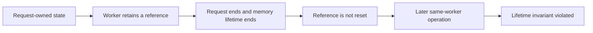
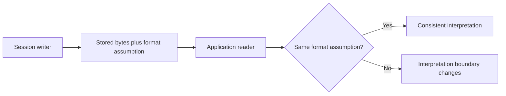

# PHP2Shell: independent reproduction, lifecycle analysis, and patch validation

**Charles Vosburgh · Public research edition · Research cutoff: November 2, 2026**

[Overview](../README.md) · [Applications](application-results.md) · [Evidence](evidence-and-counting.md) · [References](references.md)

## Abstract

This investigation examined PHP2Shell through source analysis, controlled laboratory observations, vulnerable/fixed comparisons, and application-specific tests. The retained campaign report describes five mechanism families that produced target-side effects. It also records incomplete chains and negative results that prevented broader claims.

Three assigned PHP vulnerabilities form the baseline: CVE-2026-109618, CVE-2026-109619, and CVE-2026-115560. Other investigated mechanisms required an independent application flaw or a deliberately assisted fixture. Five mechanism families therefore do not mean five new CVEs, five vulnerable default deployments, or five portable exploits.

This edition preserves the substantive research conclusions while excluding operational exploitation components. Its public examples demonstrate abstract invariants and review recorded data. They are not the original experiments, and running them does not reproduce PHP code execution.

## 1. Evidence vocabulary and scope

A **recorded target effect** is a target-side marker or command-output artifact described in the retained laboratory evidence. A **negative control** is a deliberately changed condition under which that effect was not observed. A **bounded negative result** is a failure of a particular tested route or configuration, not proof that no other route exists.

**Source analysis**, **recorded runtime observation**, **archived receipt verification**, and **fresh reproduction** are different assurance levels. The public-edition build reviewed source documents and selected code, transcribed factual records, and checks the exported material. It did not rerun the original PHP exploitation experiments. The full underlying traces are not included, so this release cannot independently establish every historical observation from public bytes alone.

The primary private-source snapshot is identified in [provenance](references.md). No private Git ancestry or executable archive is imported into this repository.

## 2. Vulnerability taxonomy

| Identifier | Invariant examined | Recorded local result |
|---|---|---|
| CVE-2026-109618 | Exceptional OOM handling must not expose partially initialized request state to later cleanup | Isolated target effects in four vulnerable PHP branches; fixed and inert controls negative |
| CVE-2026-109619 | Worker-global references must not outlive request-owned memory | Combined OOM/stale-state effects; separate no-OOM stale-state and worker-abort observations |
| CVE-2026-115560 | Session writer and reader must agree on serialization format | Conditional installed-application effects under a runtime handler change |

The first two issues were disclosed by PHP on October 21, 2026. PHP's October 23 notice describes the separate conditional upload-progress/handler-switch problem. The primary notices were checked for this public edition on November 3; historical laboratory conclusions remain dated to November 2. [U1–U3 in References](references.md).

Older research notes had mislabeled pre-request-initialization object injection as CVE-2026-109619. That taxonomy is not carried forward. Stale cross-request state, assisted early object decoding, and a serialization-handler mismatch must be evaluated separately.

## 3. CVE-2026-109618: exceptional OOM handling

### The invariant

The source report describes an operation that makes request data reachable before initialization has finished. An allocation failure can interrupt that operation. Cleanup then encounters state whose ordinary initialization or ownership assumptions no longer hold.

This is more specific than a generic memory-exhaustion denial of service. The question is what later code believes about the abandoned state. Request cleanup and the server interface matter because they determine whether invalid state is consumed or the affected worker is terminated first.

### What the retained tests report

The isolated OOM comparison records target effects on PHP 8.2.34, 8.3.35, 8.4.26, and 8.5.11. Each branch has a fixed-version comparison and an inert control, yielding four effects and eight controls in the selected cohort.

| Branch | Vulnerable member | Core-fixed member |
|---|---|---|
| 8.2 | 8.2.34 | 8.2.35 |
| 8.3 | 8.3.35 | 8.3.36 |
| 8.4 | 8.4.26 | 8.4.27 |
| 8.5 | 8.5.11 | 8.5.12 |

The isolated execution proofs used disabled ASLR and addresses calibrated to the laboratory image. Those are material experimental conditions. They establish neither portable address discovery nor general ASLR-enabled OOM-only exploitation. The public export retains the limitation but not calibration data, allocation recipes, or triggering request generators.

### Patch interpretation

The retained analysis describes a change from an abrupt OOM bailout to handling that avoids exposing partial state to ordinary shutdown. The general engineering lesson is to preserve initialization and cleanup invariants across exceptional exits. A successful negative control on a patched build supports the tested path; it does not certify all application code or other session mechanisms.

## 4. CVE-2026-109619: request lifetime versus worker lifetime

### Two lifetimes

A persistent PHP worker serves multiple requests. Request memory is short-lived; some global state survives at worker scope. Correctness requires that persistent references be reset before request-owned memory is released, including exceptional and late-cleanup paths.

The retained research reasons about a producer that leaves a stale reference and a later consumer that acts on it before normal initialization repairs the state. The relevant requests must be handled by the same worker for that particular chain. This is a condition of the observed mechanism, not a mitigation.

This diagram is conceptual. It contains no request sequence, payload, address information, or targeting procedure.

### Combined chain versus isolated attribution

The strongest recorded local execution results used an OOM producer with a stale-state consumer. The research therefore associates those outcomes with conditions from both 109618 and 109619. They are not independent proof that the no-OOM path alone produced execution.

Worker-pool experiments recorded that scheduling could change the outcome. The public conclusion is that process placement affected the tested requests and that some unsaturated cases also produced an effect. Pool-occupancy settings, scheduling code, fingerprinting, retry tuning, and operational timing recipes are intentionally not published. The observations do not establish a universal success probability.

### No-OOM investigations

The PHP 8.5 investigation separately recorded stale state and worker aborts without the OOM producer. The related state/setting was present in the tested 8.5 images and absent from the tested 8.2–8.4 images. That limits this particular producer, not the whole vulnerability class on older branches.

Matched fixed-version and changed-condition controls survived. **Standalone no-OOM CVE-2026-109619 RCE independently established by this local campaign: zero.** This does not contradict or reduce the PHP project's broader advisory impact; the upstream result and the independent laboratory result are different claims.

Additional session-state analysis recorded a stale session-name consumer and an availability effect. It is catalogued as a variant of the lifetime issue, not another CVE. Specific triggering diagnostics and combinations are withheld from this edition.

## 5. CVE-2026-115560: serialization agreement across application startup

### The boundary

The report examines session data produced before ordinary application startup and read later under a different serialization handler. The relevant non-default initial handlers are `php_binary` or `php_serialize`; the application changes the runtime handler to `php`. Upload progress, actual session storage use, and application behavior all matter.

The important invariant is not merely that a string exists in a session file. The writer's format and the reader's format must agree. Application-level reachability and available object behavior are separate prerequisites beyond the mismatch itself.

The public model uses labels, not PHP serialization syntax, object data, or a decoder that can instantiate classes.

### Installed Moodle observations

The unified selector records fourteen target effects and twenty-nine controls across eleven configured installed-site runs. It covers Moodle 4.5.15, 5.1.8, 5.2.4, and 5.3, with selected PHP 8.2.35, 8.3.36, 8.4.27, and 8.5.12 configurations using Apache/mod_php and FPM.

That list must not be read as a claim that every Cartesian combination was tested. The detailed private run matrix records the combinations; this public cohort summarizes its documented coverage. Earlier direct Moodle runs overlap with the selector and are not added again.

The retained temporal checks distinguish the absence of the marker before the relevant application read from its appearance afterward. Default-handler and progress-disabled controls were negative. These are useful controls because they test the role of the serialization and upload-progress conditions rather than merely demonstrating that an arbitrary gadget can execute in a test program.

The conclusion is conditional application coverage of a known issue—not a default Moodle vulnerability and not evidence that the first two PHP fixes failed.

### Other applications and third-party serializers

Symfony and CakePHP experiments also recorded conditional effects with explicitly selected application behavior or fixtures. Their ordinary/default configurations did not automatically supply the needed path. WordPress and Laravel ordinary-route tests illustrate the converse: a native progress record may exist without the framework reading it.

The research also records a third-party serializer hardening observation. It did not establish an unauthenticated stock-application path delivering an exploitable object in the required context. That absence remains a proof gap. Potentially unpublished trigger details and full serializer experiments are not reproduced here.

## 6. Application session-file inclusion

A different family combined upload-progress storage with an independent application file-inclusion flaw. The selected Apache cohort records eight target effects and twenty-four controls across the eight PHP releases in the vulnerable/fixed pairs.

The key causal distinction is the separate application sink. The relevant behavior remaining possible on a core-fixed PHP version does not establish a bypass of the core memory-safety patches. It establishes that a separate application flaw still changes the security boundary.

The public edition retains the dependence and experimental results but no inclusion payload, vulnerable endpoint implementation, session-location recipe, or chaining client. Its offline model merely distinguishes the existence of stored data from the presence of a separate application reader/sink.

## 7. Conditional mid-script decoding

The retained report records an assisted fixture in which application-side operations and later parsing/decoding produced a target effect. Real framework parsing methods appeared in some experiments, but the complete unmodified application source-to-sink route was not established.

An application fixture supplying an object-writing primitive or usable gadget changes the threat model. Invoking an actual framework method inside that fixture does not establish a stock-framework vulnerability. The record therefore keeps this as a conditional mechanism with unresolved exact assignment, rather than attaching it to one of the core CVEs without further evidence.

Its public example models a conjunction of prerequisites. It does not write object data, parse requests, instantiate a gadget, or execute a command.

## 8. Application and SAPI coverage

The seven named study families comprise applications, frameworks, and a server/runtime. Their labels must not be used as a list of seven vulnerable products. [Application results](application-results.md) retains individual versions, interfaces, positive conditions, negative paths, and proof limits.

The reusable lesson is that a write primitive and a read primitive must be observed independently. Similar names for storage or sessions do not prove the framework consumes the same data. Negative native-session readback results are not blanket immunity to PHP core defects or to plugins/custom code.

## 9. Related issues, failed paths, and novelty

The campaign tracks php-src issue GH-24481 separately as reentrant unserialization UAF research. It is not included in the three-CVE/five-family aggregate as an additional PHP2Shell CVE. The public reference is retained; its executable reproducer is not.

Assisted early object decoding does not fill the independent no-OOM execution gap. Third-party serializer behavior does not become a new remote vulnerability until the required real application path is established. Additional variants of an existing root cause are not counted as novel CVEs merely because they use a different SAPI, release, or application.

Bounded Drupal, WordPress, Laravel, FrankenPHP, and memory-layout negatives remain part of the result. They identify exactly where the tested chain stopped. They do not prove an entire product safe. See [negative results](negative-results.md).

## 10. What the aggregate does and does not mean

The public arithmetic is intentionally limited:

- OOM-only selector: 4 effects and 8 controls.
- Unified Moodle selector: 14 effects and 29 controls.
- Apache session-file inclusion: 8 effects and 24 controls.
- Selected total: 26 effects and 61 controls.

Other worker-pool, FPM, application, and diagnostic experiments are not silently added. Controls are not failed attacks, and target effects are not necessarily unique victims, independent deployments, or separate vulnerabilities. The archive does not supply a denominator suitable for a campaign-wide success percentage.

## 11. Verification and reproducibility limits

Public utilities verify the arithmetic, schema, declared references, and publication boundary. Offline examples test their own abstract state transitions. They do not run PHP memory corruption or recreate private observations.

Original artifact digests identify retained private evidence. They cannot prove a statement without the corresponding bytes, and they are not checksums of these rewritten public summaries. Access to additional material is manual through [research access](../RESEARCH_ACCESS.md).

A peer reviewer can inspect the public mechanism explanation, historical test matrix, controls, attribution, and internal consistency. Reproducing the original execution results requires additional material and an appropriate authorized environment; this release does not pretend otherwise.

## 12. Engineering conclusions

Exceptional exits must preserve cleanup invariants. Persistent workers must not retain references beyond request lifetime. Encoding agreement across layers must be explicit. A patched runtime and a safe application configuration are related but separate questions. A fixture must not be presented as proof of default exposure, and a negative route must not become a universal safety claim.

Those conclusions are useful without publishing every component that made a laboratory exploit operational. This public edition is a research record with non-operational examples, not an obfuscated copy of the full scripts.

[Remediation and dated advisory guidance](remediation.md) · [References and attribution](references.md)
